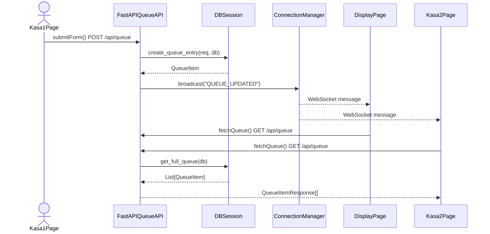

# kovzanka

Застосунок на FastAPI для управління чергою та видачею ковзанів на ковзанці:
авторизація персоналу, каси реєстрації, табло черги в реальному часі,
відстеження статусу талона та облік наявності ковзанів.

## Стек

- **Python** 3.11+
- **FastAPI** — веб-фреймворк
- **SQLAlchemy** — робота з базою даних
- **Pydantic** — валідація даних
- **Uvicorn** — ASGI-сервер
- **SlowAPI** — обмеження частоти запитів (rate limiting)
- **Jinja2** — серверний рендеринг шаблонів
- **Alpine.js** — реактивність на фронтенді
- **Tailwind CSS** — стилізація
- **uv** — керування залежностями та віртуальним середовищем

## Структура проєкту

```
kovzanka/
├── app/                    # backend-код застосунку
│   ├── api/                # ендпоінти API
│   │   ├── auth.py         # авторизація персоналу (PIN + сесійні куки)
│   │   ├── pages.py        # маршрутизація HTML-сторінок
│   │   └── queue.py        # API черги, WebSocket, статуси, інвентар
│   ├── db.py               # підключення до бази даних (SQLAlchemy engine/session)
│   ├── inventory.py        # розрахунок наявності ковзанів у реальному часі
│   ├── limiter.py          # налаштування rate limiting (SlowAPI)
│   ├── models.py           # моделі БД (SQLAlchemy)
│   ├── schemas.py          # схеми запитів/відповідей (Pydantic)
│   └── ws_manager.py       # менеджер WebSocket-з'єднань (живе оновлення табло)
├── static/                 # фронтенд-сторінки (HTML + Alpine.js + Tailwind)
│   ├── js/                 # винесені JavaScript-модулі
│   ├── index.html          # головна / навігація між касами
│   ├── login.html          # сторінка входу персоналу
│   ├── kasa1.html          # каса реєстрації №1
│   ├── kasa2.html          # каса реєстрації №2
│   ├── staff.html          # панель персоналу
│   ├── display.html        # табло черги (оновлюється через WebSocket)
│   ├── inventory.html      # сторінка обліку ковзанів
│   └── status.html         # сторінка статусу талона за токеном
├── .env                    # змінні середовища (WORKER_PIN)
├── Dockerfile              # Docker-образ для запуску
├── docker-compose.yml      # оркестрація через Docker Compose
├── ice_rink.db             # SQLite-база даних (створюється автоматично)
├── main.py                 # точка входу — FastAPI-застосунок
├── pyproject.toml
└── uv.lock
```

> Файл `ice_rink.db` — SQLite-база, вона створюється автоматично при першому
> запуску (див. `app/db.py`) і в git зазвичай не комітиться.

## Конфігурація

Створіть файл `.env` у корені проєкту:

```ini
WORKER_PIN=1234
```

`WORKER_PIN` — PIN-код для входу персоналу. Змініть на свій.

## Вимоги

- Встановлений [uv](https://docs.astral.sh/uv/getting-started/installation/)
- Python 3.11+ (uv підтягне потрібну версію автоматично, якщо її ще немає)

## Встановлення

Клонуйте репозиторій і встановіть залежності:

```bash
git clone https://github.com/Tempos/kovzanka.git
cd kovzanka
uv sync
```

Команда `uv sync` створить віртуальне середовище (`.venv`) і встановить усі
залежності з `pyproject.toml` (`fastapi`, `pydantic`, `sqlalchemy`, `uvicorn`,
`slowapi`, `jinja2`, `python-dotenv`).

## Запуск

### Локально

```bash
uv run uvicorn main:app --reload
```

Після запуску застосунок буде доступний за адресою:

```
http://127.0.0.1:8000
```

Прапорець `--reload` перезапускає сервер при зміні коду — зручно для розробки,
для продакшн-запуску його слід прибрати.

### Docker Compose

```bash
docker compose up --build
```

Застосунок запуститься на порту `8000` з підключеним `.env` файлом.

### Інтерактивна документація API

Swagger UI доступний за адресою `http://127.0.0.1:8000/docs` (потрібен вхід
персоналу).

## Авторизація персоналу

Персонал входить через сторінку `/login`, ввівши PIN-код, заданий у
`WORKER_PIN` у файлі `.env`. Після входу видається сесійна HTTP-only кука
`worker_session`, яка використовується для захисту приватних сторінок та API.

- **POST `/api/login`** — вхід за PIN (обмежено 5 спроб на хвилину).
- **POST `/api/logout`** — вихід (видалення сесійної куки).

Захищені сторінки: `/kasa1`, `/kasa2`, `/staff`, `/docs`.

## Rate Limiting

API входу захищений обмеженням частоти запитів через SlowAPI:
- `/api/login` — максимум 5 спроб на хвилину з однієї IP-адреси.

## Сторінки

- **Головна** (`/`) — навігація між касами.
- **Вхід персоналу** (`/login`) — авторизація за PIN-кодом.
- **Каси реєстрації** (`/kasa1`, `/kasa2`) — форми реєстрації гостя в чергу з вибором розмірів ковзанів та тривалості сесії. Потрібен вхід персоналу.
- **Панель персоналу** (`/staff`) — загальна панель для персоналу. Потрібен вхід.
- **Табло черги** (`/display`) — екран для загального перегляду, оновлюється в реальному часі через WebSocket.
- **Інвентар** (`/inventory`) — відображення наявності ковзанів за розмірами в реальному часі. Потрібен вхід.
- **Статус талона** (`/status`) — публічна сторінка перевірки статусу за токеном або номером талона.

## Статуси черги

| Статус | Опис |
|---|---|
| `ЧЕКАЄ` | Гість очікує у черзі |
| `ВИКЛИКАЄТЬСЯ` | Гостя викликають до каси |
| `ОБСЛУГОВУЄТЬСЯ` | Гість отримав ковзани, сесія активна |
| `ПОВЕРНЕНО` | Ковзани повернено, сесія завершена |
| `СКАСОВАНО` | Запис скасовано |

## Інвентар ковзанів

Система відстежує наявність ковзанів за розмірами (26–48). При старті кожен
розмір має 10 пар. Модуль `app/inventory.py` у реальному часі обчислює:

- Кількість пар у використанні (`in_use`)
- Кількість пар у черзі (`in_queue`)
- Доступні пари (`available`)
- Орієнтовний час вільної пари (`next_available_in_mins`)

API: `GET /api/inventory` (потрібен вхід персоналу).

## Workflow



## Зупинка

`Ctrl + C` у терміналі, де запущено сервер.

Для Docker:

```bash
docker compose down
```

## Розробка

Додати нову залежність:

```bash
uv add <назва-пакета>
```

Оновити всі залежності до версій, дозволених у `pyproject.toml`:

```bash
uv sync --upgrade
```
